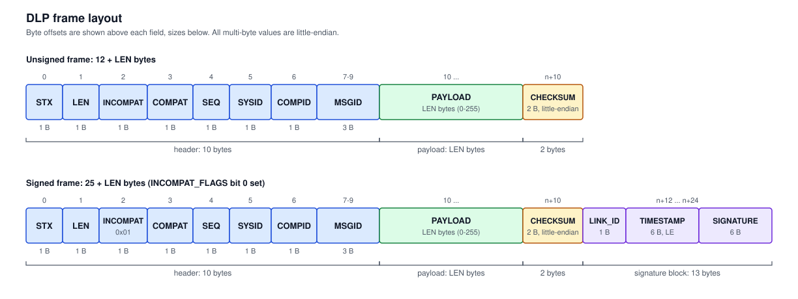
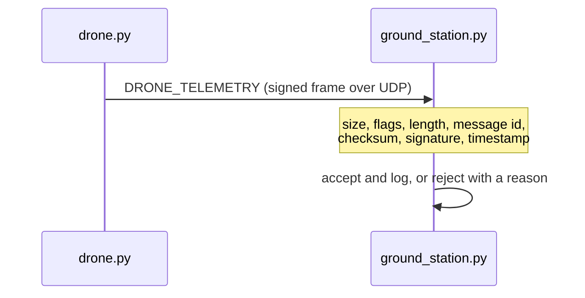

<p align="center">
  
</p>

# Drone Link Lab

A MAVLink 2 style telemetry link between a simulated drone and a ground station, built from raw bytes in Python. Every frame is checked for damage with a CRC and authenticated with a truncated HMAC-SHA256 signature and a timestamp.

The project is a study of how a real drone protocol is put together: how frames are laid out, validated, signed, and what each layer of protection does and does not stop. Everything runs locally between two programs on `127.0.0.1`.

**Live demo:** <https://viktor-in-the-wire.github.io/drone-link-lab/>, a wireframe 3D drone, signed frames on a simulated link, and attacks the receiver rejects (runs in the browser; source in [`docs/`](docs/SITE.md)).



## What it does

- Builds and parses binary frames with `struct`: header, payload, checksum, signature block
- Signs frames with HMAC-SHA256 (48-bit signature) and a 48-bit timestamp, and verifies them with a constant-time comparison
- Rejects malformed, damaged, forged and altered frames, with a reason for each rejection
- Packs telemetry into a compact 13-byte payload, including a status byte of bit flags

See [Project status](#project-status) for what is finished and what is planned.

## How it works



The full definition of the frames, the checksum, the messages and the signing rules is in the **[protocol specification](docs/PROTOCOL.md)**.

## Quick start

Requires Python 3.10 or newer.

```bash
# 1. create an environment and install the dependency
python -m venv .venv
.venv\Scripts\activate          # Windows
# source .venv/bin/activate     # Linux / macOS
pip install -r requirements.txt

# 2. create your key (32 random bytes as 64 hex characters)
copy .env.example .env          # Windows   (cp .env.example .env on Linux / macOS)
python -c "import secrets; print(secrets.token_hex(32))"
# paste the printed value into .env as KEY=...

# 3. run the two programs in two terminals
python ground_station.py
python drone.py
```

The ground station writes accepted telemetry to `connection.log`.

## Protocol at a glance

| Item | Value |
|---|---|
| Transport | UDP, one frame per datagram, `127.0.0.1` |
| Byte order | little-endian |
| Frame | 10-byte header, payload (0-255 bytes), 2-byte checksum, 13-byte signature |
| Checksum | CRC-16/MCRF4XX with `CRC_EXTRA` |
| Signature | first 6 bytes of HMAC-SHA256, 32-byte key |
| Replay protection | strictly increasing 48-bit timestamp per stream |
| Messages | `HEARTBEAT`, `DRONE_TELEMETRY`, `DRONE_COMMAND`, `DRONE_ACK` |

## Project status

- [x] Frame builder and parser
- [x] HMAC-SHA256 signing and verification
- [x] 48-bit timestamp in the signature block
- [x] Telemetry payload and status flags
- [ ] CRC-16/MCRF4XX with `CRC_EXTRA` (conformance vectors in the specification)
- [ ] Little-endian payload and checksum bytes
- [ ] Timestamp replay protection and lost-frame counting
- [ ] `DRONE_COMMAND` and `DRONE_ACK`
- [ ] Attack scripts (forge, alter, replay) and the defences against them
- [x] Live visualisation of the link (browser demo in `docs/`)

## Repository layout

```
drone-link-lab/
├── drone.py              simulated drone: builds, signs and sends frames
├── ground_station.py     ground station: receives, verifies and logs frames
├── docs/
│   ├── PROTOCOL.md       protocol specification
│   ├── index.html        live demo site (GitHub Pages, served from /docs)
│   ├── js/, assets/, styles.css, SITE.md
│   └── images/           diagrams used in the documentation
├── .env.example          template for the secret key
├── requirements.txt
├── LICENSE
└── README.md
```

## Security notes

- The secret key lives in `.env`, which is excluded from version control. Generate your own key; never reuse a published one.
- Signing proves who sent a frame and that it was not changed. It does not encrypt the traffic.
- This is an educational project for use on your own machine. It is not intended for use with real aircraft or radio equipment.

## References

- [MAVLink serialization](https://mavlink.io/en/guide/serialization.html) and [message signing](https://mavlink.io/en/guide/message_signing.html)
- [RFC 2104: HMAC](https://www.rfc-editor.org/rfc/rfc2104) and [RFC 6234: SHA-2](https://www.rfc-editor.org/rfc/rfc6234)
- [RFC 768: UDP](https://www.rfc-editor.org/rfc/rfc768)
- [CRC-16/MCRF4XX in the CRC catalogue](https://reveng.sourceforge.io/crc-catalogue/16.htm)

The complete list is in section 13 of the [specification](docs/PROTOCOL.md#13-references).

## Acknowledgements

Code by Viktor Grozdev. The specification and diagrams were drafted with the help of Claude (Anthropic) and checked against the MAVLink documentation.

## License

[MIT](LICENSE)
