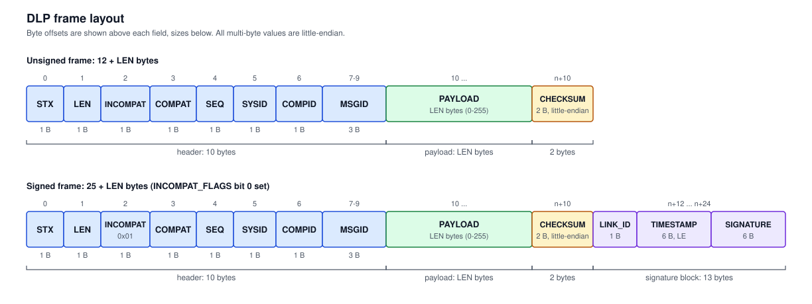
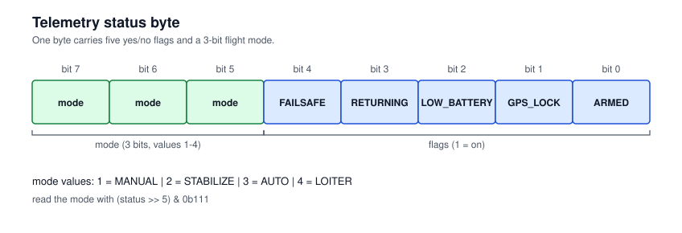
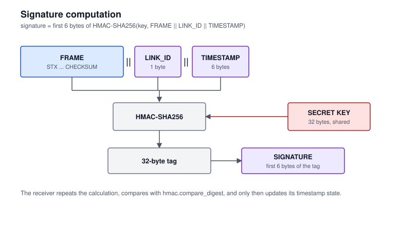
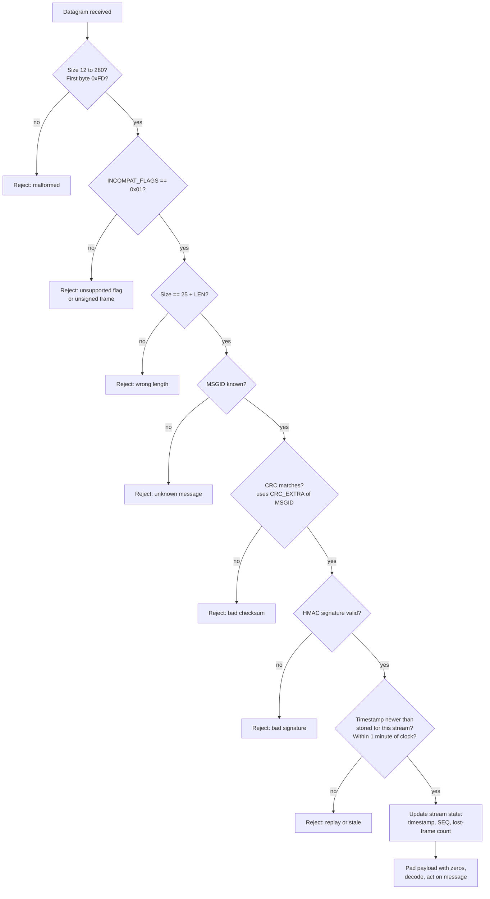

# Drone Link Protocol (DLP) Specification

| | |
|---|---|
| **Version** | 1.0 (draft) |
| **Date** | 2026-11-16 |
| **Author** | Viktor Grozdev |
| **Status** | Working specification for the Drone Link Lab reference programs |

## Abstract

The Drone Link Protocol (DLP) is a small binary protocol for the link between a simulated drone and a ground station. It carries telemetry from the drone, commands from the ground station, and acknowledgements, over UDP. Frames follow the structure of MAVLink 2 [1], and every frame is authenticated with a truncated HMAC-SHA256 signature and a monotonic timestamp. This document defines the frame format, the checksum, the messages, the signing procedure, and the rules a receiver follows to accept or reject a frame.

The key words MUST, MUST NOT, SHOULD and MAY are used as described in RFC 2119 [8].

## Contents

1. [Design basis](#1-design-basis)
2. [Conventions](#2-conventions)
3. [Frame format](#3-frame-format)
4. [Checksum](#4-checksum)
5. [Payload encoding](#5-payload-encoding)
6. [Messages](#6-messages)
7. [Signing](#7-signing)
8. [Receiver processing](#8-receiver-processing)
9. [Security considerations](#9-security-considerations)
10. [Worked examples](#10-worked-examples)
11. [Conformance test vectors](#11-conformance-test-vectors)
12. [Scope and limitations](#12-scope-and-limitations)
13. [References](#13-references)

---

## 1. Design basis

DLP is built on the published MAVLink 2 design, which is widely used between drones and ground control software. The table shows where each part of DLP comes from.

| Part | Definition | Source |
|---|---|---|
| Frame structure (10-byte header, payload, 2-byte checksum) | MAVLink 2 | [1] |
| Byte order (little-endian) | MAVLink 2 | [1] |
| Checksum: CRC-16/MCRF4XX with a per-message `CRC_EXTRA` seed | MAVLink 2 | [1], [4] |
| Payload field ordering and trailing-zero truncation | MAVLink 2 | [1] |
| Signature block (link id, 48-bit timestamp, 48-bit signature) and timestamp rules | MAVLink 2 | [2] |
| `HEARTBEAT` message | MAVLink common message set | [3] |
| Signature algorithm: HMAC-SHA256, truncated to 48 bits | DLP | [5], [6] |
| Messages `DRONE_TELEMETRY`, `DRONE_COMMAND`, `DRONE_ACK` (ids 42000-42002) | DLP | this document |
| Transport: UDP, one frame per datagram | DLP | [7] |
| Signing is mandatory | DLP | this document |

**On the signature algorithm.** MAVLink 2 forms its signature from a SHA-256 hash over the secret key followed by the frame data [2]. DLP computes the same 48-bit signature field with HMAC [5], the standardised construction for keyed hashing, so that the security of the scheme rests on a published analysis and not on how the key and data are concatenated. The inputs, the 13-byte layout, and the truncation length are the same as in MAVLink 2.

**Interoperability.** Because of this choice and the custom messages, a signed DLP frame is not verifiable by an unmodified MAVLink implementation. The frame structure, the checksum, and `HEARTBEAT` are compatible with MAVLink 2.

---

## 2. Conventions

- **Byte order.** Every multi-byte value is **little-endian**: the low byte is sent first. DLP has no big-endian fields.
- **Sizes** are in bytes. "B" means bytes in the diagrams.
- **Hexadecimal** values are written `0x1F` in text and as space-separated byte pairs (`1f a4 00`) when they are bytes on the wire.
- **Integer types** use the C names `uint8_t`, `uint16_t`, `uint32_t` and `int32_t` for unsigned and signed integers of 8, 16 and 32 bits.
- **`||`** means concatenation of byte strings.

---

## 3. Frame format



*Figure 1. Layout of an unsigned and a signed frame.*

A frame is carried in exactly one UDP datagram [7]. Its total size is **12 + LEN** bytes without a signature and **25 + LEN** bytes with one, so the smallest frame is 12 bytes and the largest is 280 bytes.

### 3.1 Fields

| Offset | Field | Size | Description |
|---|---|---|---|
| 0 | `STX` | 1 | Start marker, always `0xFD`. |
| 1 | `LEN` | 1 | Number of payload bytes actually sent, 0-255 (after truncation, see 5.2). |
| 2 | `INCOMPAT_FLAGS` | 1 | Flags the receiver MUST understand. Bit 0 (`0x01`) means the frame is signed. A frame with any other bit set MUST be rejected. |
| 3 | `COMPAT_FLAGS` | 1 | Flags the receiver MAY ignore. Senders set it to `0x00`. |
| 4 | `SEQ` | 1 | Sequence number. The sender increments it by 1 for each frame and wraps from 255 to 0. |
| 5 | `SYSID` | 1 | Identifier of the sending system, 1-255. The drone is `1`; the ground station is `255`. |
| 6 | `COMPID` | 1 | Identifier of the sending component, 1-255. Always `1` in DLP. |
| 7-9 | `MSGID` | 3 | Message identifier, a 24-bit value, low byte first. |
| 10 ... n+9 | `PAYLOAD` | `LEN` | Message data (Section 5). |
| n+10, n+11 | `CHECKSUM` | 2 | CRC-16 over the frame (Section 4), low byte first. |
| n+12 ... n+24 | `SIGNATURE` | 13 | Signature block (Section 7). Present if and only if `INCOMPAT_FLAGS` bit 0 is set. |

In DLP every frame MUST be signed, so `INCOMPAT_FLAGS` is `0x01` on every frame that is sent.

### 3.2 Sequence numbers

`SEQ` is used to **detect lost frames**. A receiver keeps the last `SEQ` it accepted for each sender and computes the number of frames missed as `(received - expected) mod 256`. A gap is not an error and MUST NOT cause a frame to be rejected. `SEQ` takes no part in replay protection; that is the job of the timestamp (Section 7.4).

---

## 4. Checksum

### 4.1 Algorithm

DLP uses **CRC-16/MCRF4XX**, which the MAVLink documentation also calls X.25 [1]. Its parameters, from the CRC catalogue [4]:

| Parameter | Value |
|---|---|
| Width | 16 bits |
| Polynomial | `0x1021` |
| Initial value | `0xFFFF` |
| Input reflected | yes |
| Output reflected | yes |
| Final XOR | `0x0000` |
| Check value (`"123456789"`) | `0x6F91` |

One input byte is folded into the running CRC like this:

```python
def crc_accumulate(crc, byte):
    tmp = byte ^ (crc & 0xFF)
    tmp = (tmp ^ (tmp << 4)) & 0xFF
    return ((crc >> 8) ^ (tmp << 8) ^ (tmp << 3) ^ (tmp >> 4)) & 0xFFFF
```

> **Note.** The CRC-16 in Python's `binascii.crc_hqx` is a different variant (CCITT, not reflected) and does not produce this checksum.

### 4.2 Coverage

The checksum covers every byte of the frame **except** `STX` and the signature block, followed by one extra byte, `CRC_EXTRA`, that is **not transmitted**:

```
  STX | LEN  INCOMPAT  COMPAT  SEQ  SYSID  COMPID  MSGID | PAYLOAD | CRC_EXTRA
   -  |<--------------------- covered ---------------------------->|<- covered ->
 not                                                                  not sent
 covered
```

The two checksum bytes are sent low byte first.

### 4.3 `CRC_EXTRA`

`CRC_EXTRA` is a one-byte seed derived from the **definition** of a message [1]. If a sender and a receiver disagree about the fields of a message, their `CRC_EXTRA` values differ and the checksum fails, so a version mismatch is detected.

It is computed as follows:

1. Start a CRC-16/MCRF4XX with the message name followed by a space.
2. For each field in **wire order**, add the type name and a space, then the field name and a space. For an array field, also add one byte holding the array length.
3. Fold the 16-bit result to 8 bits: `(crc & 0xFF) ^ (crc >> 8)`.

For `HEARTBEAT` the result is **50**, which matches the published value.

---

## 5. Payload encoding

### 5.1 Field order

Fields are sent **largest first**: 4-byte types, then 2-byte types, then 1-byte types. Fields of the same size keep their declared order [1]. The messages in Section 6 are listed in wire order.

### 5.2 Truncation

Before sending, a sender removes **trailing zero bytes** from the payload and sets `LEN` to the new length [1].

- Zero bytes in the middle of the payload are kept.
- The first byte is never removed, so a payload that is all zero is sent as one byte.
- The checksum is calculated over the truncated payload.
- A receiver MUST pad the payload with zero bytes up to the full size of the message **before** decoding it.

```
full payload:   01 00 00     (command 1, result 0)
sent payload:   01           (LEN = 1)
```

---

## 6. Messages

| `MSGID` | Name | Direction | Payload | `CRC_EXTRA` |
|---|---|---|---|---|
| 0 | `HEARTBEAT` | drone to ground | 9 bytes | 50 |
| 42000 | `DRONE_TELEMETRY` | drone to ground | 13 bytes | 52 |
| 42001 | `DRONE_COMMAND` | ground to drone | 7 bytes | 54 |
| 42002 | `DRONE_ACK` | drone to ground | 3 bytes | 226 |

Identifiers 42000-42002 are chosen by DLP. They are not part of the MAVLink common message set [3].

### 6.1 `HEARTBEAT` (0)

Announces that the drone is alive; sent about once per second. Defined in the MAVLink common message set [3].

| Wire offset | Field | Type | Value used in DLP |
|---|---|---|---|
| 0-3 | `custom_mode` | `uint32_t` | `0` |
| 4 | `type` | `uint8_t` | `2` (quadrotor) |
| 5 | `autopilot` | `uint8_t` | `3` (ArduPilot) |
| 6 | `base_mode` | `uint8_t` | `0x81` (armed, custom mode enabled) |
| 7 | `system_status` | `uint8_t` | `4` (active) |
| 8 | `mavlink_version` | `uint8_t` | `3` |

The enumeration values are taken from the MAVLink message definitions [3].

### 6.2 `DRONE_TELEMETRY` (42000)

The drone's state, sent several times per second.

| Wire offset | Field | Type | Unit / meaning |
|---|---|---|---|
| 0-3 | `time_ms` | `uint32_t` | milliseconds since the drone started |
| 4-7 | `altitude_cm` | `int32_t` | centimeters; signed, so it can be below the take-off point |
| 8-9 | `speed_cms` | `uint16_t` | centimeters per second |
| 10 | `battery_pct` | `uint8_t` | 0-100 |
| 11 | `satellites` | `uint8_t` | GPS satellites in view |
| 12 | `status` | `uint8_t` | flag byte, Figure 2 |



*Figure 2. The `status` byte of `DRONE_TELEMETRY`.*

| Bit(s) | Name | Meaning when set |
|---|---|---|
| 0 | `ARMED` | motors armed |
| 1 | `GPS_LOCK` | GPS position fix |
| 2 | `LOW_BATTERY` | battery below the safe limit |
| 3 | `RETURNING` | returning to the launch point |
| 4 | `FAILSAFE` | failsafe active |
| 5-7 | mode | `1` MANUAL, `2` STABILIZE, `3` AUTO, `4` LOITER. Other values are reserved. |

### 6.3 `DRONE_COMMAND` (42001)

An order from the ground station to the drone.

| Wire offset | Field | Type | Meaning |
|---|---|---|---|
| 0-3 | `param` | `uint32_t` | command parameter |
| 4-5 | `command` | `uint16_t` | `1` `RETURN_HOME`, `2` `LAND`, `3` `SET_MODE` |
| 6 | `target_system` | `uint8_t` | the `SYSID` the command is for |

`param` is unused (`0`) for `RETURN_HOME` and `LAND`. For `SET_MODE` it holds the new flight mode (1-4).

### 6.4 `DRONE_ACK` (42002)

The drone's answer to a command.

| Wire offset | Field | Type | Meaning |
|---|---|---|---|
| 0-1 | `command` | `uint16_t` | the command being answered |
| 2 | `result` | `uint8_t` | `0` accepted, `1` rejected, `2` unsupported |

---

## 7. Signing

### 7.1 Signature block

The signature block follows the checksum and is 13 bytes long [2]:

| Offset in block | Field | Size | Description |
|---|---|---|---|
| 0 | `LINK_ID` | 1 | Identifies the connection the frame travels on. `0` in DLP. |
| 1-6 | `TIMESTAMP` | 6 | 48-bit unsigned integer, little-endian, in units of 10 microseconds since 1 January 2015, 00:00 GMT [2]. |
| 7-12 | `SIGNATURE` | 6 | The first 48 bits of the HMAC tag (7.3). |

To convert from Unix time: `timestamp = int((unix_seconds - 1_420_070_400) * 100_000)`.

### 7.2 Secret key

The key is **32 bytes** of binary data shared by the drone and the ground station and known to nobody else. It is never transmitted. In the reference programs it is supplied in the environment variable `KEY` as **64 hexadecimal characters** and decoded with `bytes.fromhex`. It MUST NOT be stored in source code or committed to version control.

### 7.3 Signature calculation



*Figure 3. Signature calculation.*

```
tag       = HMAC-SHA256( key,  FRAME || LINK_ID || TIMESTAMP )
SIGNATURE = tag[0:6]
```

`FRAME` is every byte from `STX` to the end of `CHECKSUM`. HMAC is defined in [5] and SHA-256 in [6]. Because `INCOMPAT_FLAGS` bit 0 is part of the frame, a signed frame cannot be passed off as an unsigned one.

A receiver compares signatures with a **constant-time** comparison (`hmac.compare_digest` in Python), never with `==`.

### 7.4 Timestamp rules

A **stream** is the combination of (`SYSID`, `COMPID`, `LINK_ID`). For each stream the receiver stores the newest timestamp it has accepted. Following [2]:

1. The sender MUST make the timestamp of every frame in a stream at least 1 larger than the one before it. If the clock would give the same value twice, the sender uses `previous + 1`.
2. The receiver MUST reject a frame whose timestamp is **not newer** than the stored one for its stream. This is what stops a recorded frame from being replayed.
3. The receiver MUST reject a frame whose timestamp is more than **6,000,000 units (one minute)** older than its own clock.
4. The first frame of a stream is accepted if it passes rule 3.
5. The stored timestamp is updated **only** from a frame whose signature has been verified.

---

## 8. Receiver processing

A receiver applies the checks below in this order. The order matters: cheap structural checks come first, and no state changes until the signature has been verified.



*Figure 4. Receiver decision flow.*

| Code | Reason | Typical cause |
|---|---|---|
| R1 | malformed | truncated datagram, noise, wrong protocol |
| R2 | unsupported flag / unsigned | unknown `INCOMPAT_FLAGS` bit, or a frame without a signature |
| R3 | wrong length | `LEN` does not match the datagram size |
| R4 | unknown message | `MSGID` not in Section 6 |
| R5 | bad checksum | bit damage, or a different message definition |
| R6 | bad signature | wrong key, or the frame was altered |
| R7 | replay or stale | a recorded frame was sent again, or the clock is wrong |

A rejected frame is never decoded, never acted on, and never changes receiver state. Implementations SHOULD log the code of each rejection.

UDP gives no delivery guarantee [7]. A sender that needs confirmation (a command) waits for a `DRONE_ACK` and resends after a timeout.

---

## 9. Security considerations

**Threat model.** An attacker who can read the link, send datagrams to either endpoint, and record and replay traffic, but who does not know the key.

| Attack | Defence in DLP |
|---|---|
| Random corruption | Checksum (Section 4) |
| Forged frame with a valid checksum | The checksum is public arithmetic, so it does not help; the HMAC signature rejects the frame (R6) |
| Modified frame | Any change breaks the signature (R6), including the timestamp and the flags |
| Replay of a recorded frame | The timestamp is not newer than the stored one (R7) |
| Replay with a raised timestamp | The timestamp is covered by the signature (R6) |
| Spoofed command from a third party | Commands are frames and need a valid signature |

**What DLP does not provide.**
- **Confidentiality.** Signing does not encrypt. Anyone who can read the link can read positions, battery levels and commands.
- **Key distribution.** Both sides are given the key in advance. If the key leaks, an attacker can sign any frame. Rotate the key after any suspected exposure.
- **Availability.** An attacker can still flood or block the link. A drone SHOULD have a failsafe behaviour for the case in which the ground station is silent.
- **Clock integrity.** Rule 3 of 7.4 relies on a reasonable clock. A device that restarts MUST NOT reuse old timestamps; it SHOULD store the last value it used and continue from the maximum of that value and the current clock [2].
- **Key strength.** HMAC is only as strong as the key. The key MUST be generated randomly (for example with `secrets.token_hex(32)`), not typed by hand.

---

## 10. Worked examples

Bytes are shown as hexadecimal pairs. Examples 10.3 and 10.4 use the **test key** `00 01 02 ... 1f` (32 bytes). It is published here and MUST NOT be used for anything else.

### 10.1 `HEARTBEAT`, unsigned (framing and checksum only)
`SEQ` 0, `SYSID` 1, `COMPID` 1:

```
fd 09 00 00 00 01 01 00 00 00  00 00 00 00 02 03 81 04 03  9f e6
\_________ header ___________/  \__________ payload _______/  \CRC/
```

| Bytes | Meaning |
|---|---|
| `fd` | `STX` |
| `09` | `LEN` = 9 |
| `00 00` | no flags |
| `00` | `SEQ` = 0 |
| `01 01` | `SYSID` 1, `COMPID` 1 |
| `00 00 00` | `MSGID` = 0 |
| `00 00 00 00` | `custom_mode` = 0 |
| `02 03 81 04 03` | `type`, `autopilot`, `base_mode`, `system_status`, `mavlink_version` |
| `9f e6` | checksum `0xE69F`, low byte first |

21 bytes in total (12 + 9).

### 10.2 `DRONE_TELEMETRY`, unsigned
`SEQ` 1:

```
fd 0d 00 00 01 01 01 10 a4 00  40 e2 01 00 12 2f 00 00 c2 01 57 09 63  23 55
```

| Bytes | Meaning |
|---|---|
| `0d` | `LEN` = 13 |
| `01` | `SEQ` = 1 |
| `10 a4 00` | `MSGID` = `0x00A410` = 42000 |
| `40 e2 01 00` | `time_ms` = 123456 |
| `12 2f 00 00` | `altitude_cm` = 12050 (120.5 m) |
| `c2 01` | `speed_cms` = 450 (4.5 m/s) |
| `57` | `battery_pct` = 87 |
| `09` | `satellites` = 9 |
| `63` | `status` = `0b01100011`: mode 3 (AUTO), `GPS_LOCK`, `ARMED` |
| `23 55` | checksum `0x5523` |

25 bytes in total.

### 10.3 `DRONE_TELEMETRY`, signed
`SEQ` 2, `LINK_ID` 0, timestamp 100,000,000 (an arbitrary example value, 1000 seconds after the start of 2015):

```
fd 0d 01 00 02 01 01 10 a4 00  40 e2 01 00 12 2f 00 00 c2 01 57 09 63  95 95
00  00 e1 f5 05 00 00  7c 74 72 59 ab 19
\_/ \_______________/  \_______________/
link   timestamp          signature
```

`INCOMPAT_FLAGS` is `01`, which changes the checksum (`0x9595`). The signature `7c 74 72 59 ab 19` is the first 6 bytes of `HMAC-SHA256(test key, frame || link_id || timestamp)`. 38 bytes in total (25 + 13).

### 10.4 `DRONE_ACK` with truncation
`SEQ` 3, `command` 1, `result` 0. The full payload `01 00 00` loses its trailing zeros:

```
fd 01 00 00 03 01 01 12 a4 00  01  49 1b
```

`LEN` is `01`, `MSGID` is `12 a4 00` (42002), and the checksum `0x1B49` covers only the one byte that was sent. The receiver pads the payload back to `01 00 00` before decoding. 13 bytes in total.

---

## 11. Conformance test vectors

An implementation is correct when it passes every row.

| # | Test | Expected result |
|---|---|---|
| 1 | CRC-16/MCRF4XX of `123456789` | `0x6F91` |
| 2 | `CRC_EXTRA` of `HEARTBEAT` | `50` |
| 3 | `CRC_EXTRA` of `DRONE_TELEMETRY`, `DRONE_COMMAND`, `DRONE_ACK` | `52`, `54`, `226` |
| 4 | Build the frame of 10.1 | exactly the bytes shown |
| 5 | Build the frames of 10.2, 10.3, 10.4 | exactly the bytes shown |
| 6 | Parse each frame of Section 10 | the original field values |
| 7 | Flip one bit anywhere in the frame of 10.2 | rejected, R5 |
| 8 | Change one payload byte of 10.3 and recompute the checksum | rejected, R6 |
| 9 | Send the frame of 10.3 twice | the second is rejected, R7 |
| 10 | Send a frame with `INCOMPAT_FLAGS = 0x02` | rejected, R2 |
| 11 | Send a 5-byte datagram | rejected, R1 |
| 12 | Send a frame whose `LEN` does not match its size | rejected, R3 |
| 13 | Send frames with `SEQ` 0, 1, 4 | all accepted, 2 frames counted as lost |

---

## 12. Scope and limitations

DLP version 1.0 does not define:
- MAVLink 1 frames (`STX = 0xFE`)
- routing between several links
- encryption of the payload
- key exchange or rotation procedures
- any use with real aircraft or radio hardware

DLP is a teaching and research protocol. The reference programs run on `127.0.0.1` between two processes on one machine.

---

## 13. References

1. MAVLink Developer Guide. *MAVLink Serialization* (packet format, CRC, truncation, field ordering). https://mavlink.io/en/guide/serialization.html
2. MAVLink Developer Guide. *Message Signing* (signature block, timestamp rules). https://mavlink.io/en/guide/message_signing.html
3. MAVLink Message Definitions. *Common message set* (`HEARTBEAT`). https://mavlink.io/en/messages/common.html
4. CRC RevEng project. *Catalogue of parametrised CRC algorithms*, entry CRC-16/MCRF4XX. https://reveng.sourceforge.io/crc-catalogue/16.htm
5. H. Krawczyk, M. Bellare, R. Canetti. *RFC 2104: HMAC: Keyed-Hashing for Message Authentication*. February 1997. https://www.rfc-editor.org/rfc/rfc2104
6. D. Eastlake 3rd, T. Hansen. *RFC 6234: US Secure Hash Algorithms (SHA and SHA-based HMAC and HKDF)*. May 2011. https://www.rfc-editor.org/rfc/rfc6234
7. J. Postel. *RFC 768: User Datagram Protocol*. August 1980. https://www.rfc-editor.org/rfc/rfc768
8. S. Bradner. *RFC 2119: Key words for use in RFCs to Indicate Requirement Levels*. March 1997. https://www.rfc-editor.org/rfc/rfc2119
9. Python Software Foundation. *struct*, *hmac* and *hashlib* modules, Python standard library documentation. https://docs.python.org/3/library/
